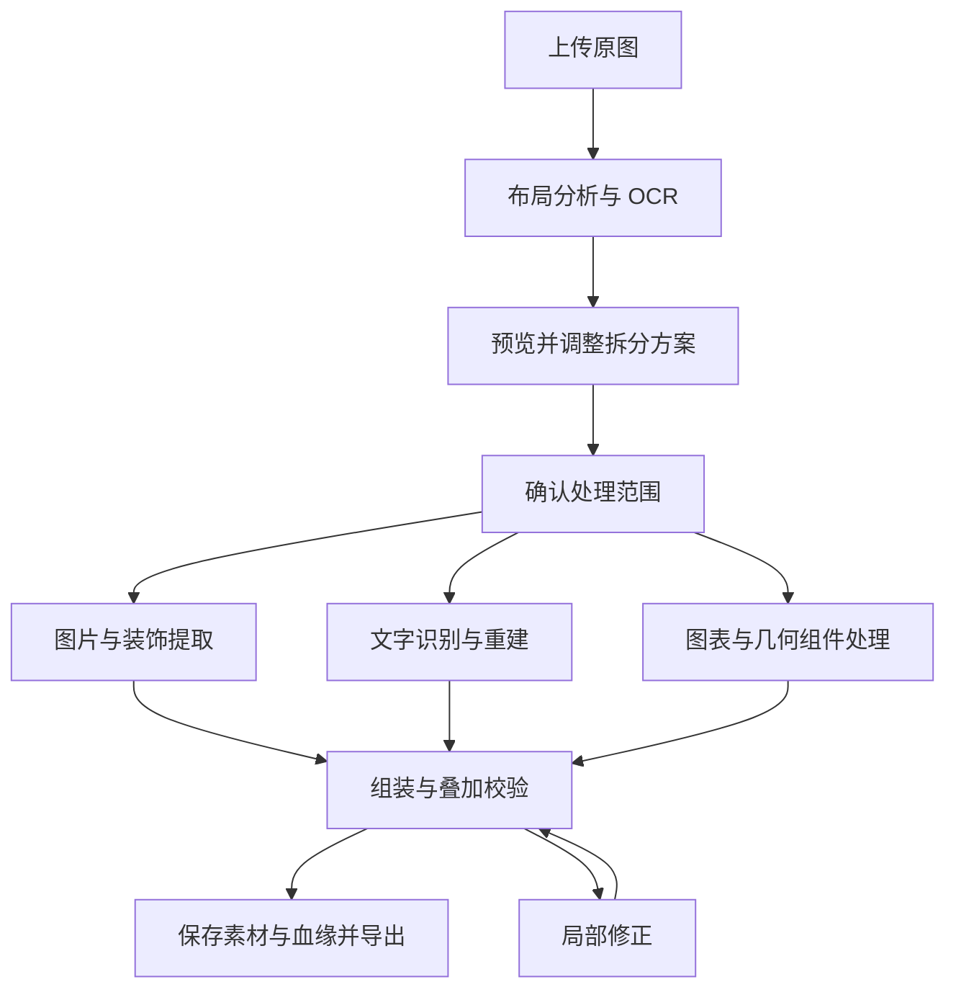
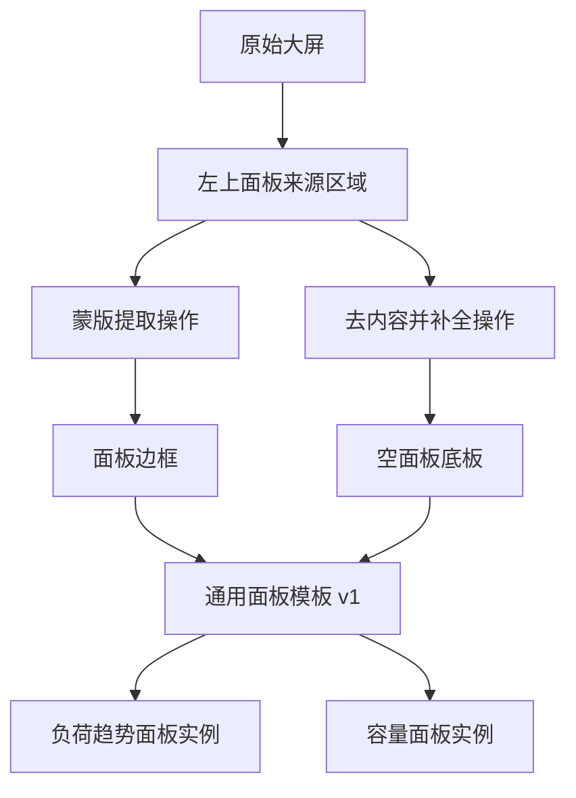

# 图层拆分与素材血缘追踪应用方案

> 版本：讨论整理稿 v1.0  
> 整理日期：2026-10-21  
> 适用场景：科技大屏、展项界面及相近的平面 UI 图片。  
> 本文汇总前期讨论，并补充实现建议；未对示例原图执行拆层、生图或 OCR。模型能力参考官方资料，不代表已通过该场景实测。

## 1. 产品目标与边界

将一张已合并的界面图片，整理为独立素材、可编辑文字及部分可复用组件，同时记录每个产物的来源、加工过程与使用位置。

应用需要回答三个问题：

1. 这张图可以拆出哪些元素？
2. 哪些元素能够原样保留，哪些需要补全或重建？
3. 每个素材来自哪里，经历了什么处理，又被用于哪里？

单张 PNG/JPG 不包含原始设计文件的完整图层信息。被遮挡的内容、原字体、图表原始数据通常不能直接恢复。自动分层模型生成的 RGBA 图层也需要检查，不能视为原始设计图层的还原。

### 1.1 三种处理方式

| 方式 | 处理内容 | 典型产物 | 必须说明的边界 |
| --- | --- | --- | --- |
| 原样提取 | 裁切、蒙版分离、边缘透明度处理 | 边框、图标、文字像素素材 | 复杂光晕与半透明叠加可能无法精确分离 |
| 补全提取 | 去掉文字、补齐遮挡、修复底板 | 空面板、完整圆环、干净背景 | 补全区域包含推测内容 |
| 可编辑重建 | 识别后重新排版或绘制 | 文字、SVG 几何图形、数据组件 | 外观需要校准，原始数据需另行提供或核实 |

三种方式均保留来源记录。补全与重建需有明确标识，并允许回看原图。

## 2. 示例大屏的拆分与复用

以下依据前期对示例大屏的讨论整理，实际范围和数量以导入原图后的分析为准。

| 模块 | 建议拆分 | 可复用用途 |
| --- | --- | --- |
| 深色背景 | 底色、网格、光点 | 同系列界面背景 |
| 全屏外框 | 外围细线、四角装饰、底部装饰 | 统一大屏视觉框架 |
| 顶部标题 | 标题底框、斜纹、独立文字 | 更换页面名称 |
| 中央圆环 | 外圈、刻度、虚线圈、定位线 | 旋转、扫描、设备状态动画 |
| 连接线 | 折线、端点、光效 | 信息节点连接 |
| 信息面板 | 底板、边框、标题装饰、内容组 | 通用空面板模板 |
| 数字卡片 | 卡片底板、数字、单位、说明、状态条 | 不同指标展示 |
| 预警进度条 | 底槽、填充、标签 | 完成率、容量、风险提示 |
| 图表 | 坐标网格、曲线或柱子、文字 | 复用视觉样式；数据独立处理 |

优先建立八类基础资产：背景、全屏外框、顶部标题框、空面板、数字卡片、进度条、连接线、分层圆环。

重复面板可归纳为模板，但不同尺寸、装饰和光效应先比较。模板拉伸需保护边角；不能简单缩放导致线宽和切角变形。

### 2.1 左上“实时负荷”面板示例

建议层级：面板组 → 底板、边框、标题装饰、标题文字、数字卡片组、状态条。

数字卡片再拆为：底板、数值、单位、说明文字。按动画和数据绑定需求选择粒度，避免把所有装饰拆成大量难以管理的细碎图层。

## 3. 整体工作流

**上传原图 → 自动分析 → 用户确认方案 → 分路处理 → 叠加检查 → 保存与导出。**

| 阶段 | 系统工作 | 用户操作与结果 |
| --- | --- | --- |
| 上传 | 保存原图、尺寸、文件摘要与版本 | 查看原图 |
| 分析 | 检测布局、文字、重复结构，提出图层建议 | 查看区域框与初步图层树 |
| 方案确认 | 为区域列出处理方式与预期产物 | 调整选区、粒度与命名，确认需要生成的部分 |
| 执行 | 按类型调用图像处理、OCR、拆层或编辑能力 | 查看各任务进度与结果，重试失败项 |
| 校验 | 按坐标组装，对照原图、透明边缘和文字 | 修正选区、文字或补全区域 |
| 保存导出 | 保存版本、图层树、模板与操作血缘 | 下载素材包与结构文件 |

**分析与生成分成两个阶段。** 用户可只分析，不生成图片；补全、去字和重建的执行范围应先展示。

血缘在每次处理发生时写入。失败任务保留失败状态，不能产生被误标为成功的资产。

## 4. 三条处理路径

### 4.1 图片与装饰

1. 优先用裁切与蒙版保留原有像素。
2. 对复杂结构测试自动拆层，再由用户检查。
3. 需要去字、补遮挡或扩展背景时调用编辑模型。
4. 保留裁切范围、蒙版、坐标变换和处理参数。
5. 在棋盘格、深色底、浅色底上检查透明边缘。

青色光晕不能直接“去黑底”：它与深色背景已混合，简单删色会损伤细线，产生暗边。分割蒙版确定区域，精细透明度仍可能需要抠图与边缘校正。无法从单张合成图唯一确定的前景颜色与透明度，应保留不确定性说明。

### 4.2 文字与数字

提供两种输出：

| 模式 | 优点 | 局限 |
| --- | --- | --- |
| 原样文字素材 | 保留现有外观，适合动画 | 不能直接改内容，透明提取也可能需修边 |
| 可编辑文字 | 可更改文本、字号和样式 | 字体与字距需匹配，重建外观存在差异 |

可编辑路径：

**OCR 检测与识别 → 校正内容 → 分析样式 → 生成去字蒙版 → 修复底板 → 重建文字 → 对照检查。**

OCR 主要提供内容和位置；字体、字重、字距、描边、阴影与发光效果需要另外估计并人工校准。文字框不是像素级字形蒙版，直接扩大矩形去字可能损伤附近边框。

数字、单位、说明和状态条分别成层，便于绑定数据。原始识别内容与用户校正内容分开保存，禁止覆盖原记录。

模糊、变形、无法辨认的字标为“待确认”，允许用户输入或保留原样，不让模型自动编造正确内容。

### 4.3 图表与几何组件

- 只需展示或动画时，可保留图表图片或局部视觉元素。
- 需要修改尺寸和样式时，可重建网格、圆环、直线等矢量元素。
- 需要更新数据时，重建图表组件，并单独获取数据来源。
- 从曲线位置估算的数据应明确标为估算，不能当作原始业务数据。

## 5. OCR 方案

对于此应用，OCR 必须返回可用的位置和识别分数，不能只返回整段文本。

| 方案 | 官方能力与接入形式 | 本应用中的候选定位 |
| --- | --- | --- |
| PaddleOCR | 开源文字检测与识别；官方已发布 PP-OCRv6 [S1] | 自部署主候选，便于控制流程 |
| RapidOCR | 提供 ONNX Runtime 等多种推理后端 [S2] | 本地工具或桌面应用候选 |
| 腾讯云通用文字识别高精度版 | API 返回文字内容、位置及置信度等信息 [S3] | 快速验证产品流程 |
| Azure Document Intelligence Read | 返回文本、位置多边形及词级置信度等 [S4] | 已使用微软云或兼顾文档处理时评估 |
| Tesseract.js | 支持浏览器与 Node.js 的 OCR [S5] | 浏览器本地识别候选，需测试中文小字 |

以上定位为方案建议，不构成识别效果排名。部署方式、成本、速度和准确率通过真实样例决定。

### 5.1 推荐识别流程

1. 全图识别，建立标题、数值、刻度等位置索引。
2. 按面板裁切，对小字适度放大、调整对比度后再次识别。
3. 将子图坐标映射回原图坐标，合并重复框与文本。
4. 把文字归入对应面板，对结果冲突、关键数字和低分区域发起人工检查。
5. 保存引擎、模型版本、预处理方式、原始结果与校正记录。

全图与局部识别的结果可能不同。识别分数也不等于真实正确概率，不同引擎的分数不可直接比较，阈值应由标注样例校准。

### 5.2 第一版选型建议

先用腾讯云高精度 OCR 跑通接口和校正流程，同时用 PaddleOCR 对同一批样例做对比。如果明确要求图片留在本地，直接以 PaddleOCR 或 RapidOCR 建立本地方案。

比较内容：中文标题、小字、青色文字、数字与单位、坐标刻度、漏检率、位置偏差、耗时及人工修改量。不要用厂商总体指标替代本场景测试。

## 6. 图层模型与图片编辑模型

| 能力角色 | 候选 | 应用中的用途与限制 |
| --- | --- | --- |
| 自动图层分解 | Qwen-Image-Layered | 官方支持将图片分解成多个 RGBA 图层 [S6]；适合初拆实验，需检查细线、文字和合成误差 |
| 指令图片编辑 | Qwen-Image-Edit 系列 | 官方提供图片编辑能力 [S7]；测试去内容、补底板和制作变体 |
| 图片生成与编辑 | OpenAI GPT Image 系列 | 官方文档提供编辑、蒙版及透明背景相关能力 [S8]；按具体模型与接口确认支持 |
| 参考图生成与编辑 | FLUX.2 | 官方提供多参考图编辑等能力 [S9]；评估同风格装饰与衍生素材 |
| 对话式生成与编辑 | Gemini 图片模型 | 官方提供图片生成与编辑接口 [S10]；用于交互式修改候选 |
| 区域分割 | SAM 类模型 | 提供分割能力 [S11]；辅助选区，不负责恢复遮挡或精确分离光晕 |

**第一版建议组合：普通图像处理＋一个 OCR 引擎＋Qwen-Image-Layered 试验接入＋一个编辑模型。**

编辑模型先在 Qwen-Image-Edit 与 GPT Image 中进行同样例对比，无需一次接入全部候选。选择时核对具体版本的许可、硬件需求、输入输出格式与接口限制；本文不提供未经测试的显存、价格和耗时承诺。

蒙版引导也不应默认等于严格只改蒙版内部。对于要求保留原像素的工作，应用需明确合成策略，保存模型完整输出及实际采用区域，并检查选区外变化。

## 7. 图层树、血缘图与模板关系

### 7.1 三种关系

| 结构 | 回答的问题 | 示例 |
| --- | --- | --- |
| 图层树 | 画面由哪些元素组成，如何叠放？ | 面板组包含底板、标题和图表 |
| 加工血缘 | 素材来自哪里，经过哪些操作？ | 原图区域经过蒙版提取形成边框 |
| 复用关系 | 哪些组件或页面引用此素材？ | 通用面板模板被多个页面实例引用 |

血缘由真实操作记录建立。AI 可以建议名称或分组，但不能事后猜测来源作为正式记录。

### 7.2 血缘示例

文字保留两个分支：

- 原图文字区域 → 蒙版提取 → 原样文字素材。
- 原图文字区域 → OCR → 用户校正 → 文字重建 → 可编辑文字层。

### 7.3 版本与引用规则

- 资产 ID 不随重命名改变；每次加工产生新版本或新资产。
- 加工血缘引用精确版本，使历史可回溯。
- 模板实例保存引用版本与局部覆盖项。
- 模板更新后提示影响范围，由用户决定升级哪些实例。
- 导出的独立副本不自动同步；若需要追踪其被外部使用的位置，需额外建立导入或使用登记机制。
- 同一素材可有多个来源输入，不能只用一个“父图层 ID”代替完整血缘。

## 8. 数据记录建议

| 对象 | 关键字段 |
| --- | --- |
| 原图 Source | ID、版本、文件路径、摘要、宽高、色彩信息 |
| 区域 Region | 来源版本、多边形或矩形、蒙版、坐标系 |
| 操作 Operation | 类型、输入输出版本、模型及版本、提示词、参数、执行状态、时间 |
| 素材 Asset | ID、版本、文件、尺寸、透明通道、生成方式、来源操作 |
| 图层 Layer | 素材引用、所属组、位置、变换、层序、透明度、混合模式、显隐与锁定 |
| 文字 Text | OCR 原文、校正内容、位置、多边形、分数、字体与样式、确认状态 |
| 模板 Template | 资产引用、版本、可编辑参数与默认值 |
| 实例 Instance | 模板版本、覆盖参数、所在页面或组件 |
| 审核 Review | 待确认项、确认对象及版本、确认结果 |

统一以原图左上角为原点，记录像素尺寸；裁切、缩放、旋转后的坐标变换必须保存。来源区域与新图层的位置是不同概念，需要分别记录。

建议将加工血缘表示为“资产版本 → 操作 → 资产版本”的有向无环图；图层的组成与模板的引用另行表达。

## 9. 界面布局

采用三个主要区域：

- **左侧图层树**：分组、命名、排序、显隐、锁定与模板标记。
- **中央画布**：原图、区域框、蒙版编辑、透明素材和重新叠加。
- **右侧属性与来源**：位置、尺寸、文字、处理方式、版本、来源与待确认项。

血缘较复杂时进入完整关系图。点击素材可定位原图区域；点击区域可列出对应产物。

建议提供原图／结果切换、叠加透明度、局部放大、差异预览和补全区域标识。生成任务单独展示状态，支持取消、失败重试与保留旧版本。

## 10. 第一版开发范围

### 10.1 必做功能

1. 上传原图并保存版本。
2. 自动提出区域和文字建议，允许手动修正。
3. 为区域选择原样提取、补全或重建，并在执行前确认范围。
4. 裁切、蒙版提取、基础图层组装与显隐。
5. OCR 内容校正与基础文字层重建；字体先支持人工选择。
6. 接入一种图片编辑能力，支持局部去内容与补全。
7. 自动记录操作血缘，并联动画布定位。
8. 将资产标记为模板并创建简单实例。
9. 导出 PNG、图层结构、OCR 记录和血缘文件。

Qwen-Image-Layered 可作为试验功能接入；自动拆分失败时仍应允许通过选区和蒙版完成主流程。

### 10.2 后续扩展

自动字体匹配、参数化图表、业务数据绑定、复杂模板同步、批量处理、团队协作及专业设计工具格式导出。

PSD 等格式涉及图层与文字兼容性，第一版不默认承诺完整还原。

## 11. 实现结构与交付文件

建议由画布与图层编辑界面、业务与版本服务、异步任务队列、模型适配器和文件存储组成。任务步骤独立保存输出，以便只重试失败环节。

模型适配器统一输入图片、区域、蒙版与参数，输出文件及元数据；不同模型未支持的能力需明确返回，不用猜测填充。

导出包建议包含：

| 路径 | 内容 |
| --- | --- |
| source/original.png | 原始图及对应元数据 |
| assets/ | 透明 PNG 与其他素材 |
| masks/ | 提取、去字和补全使用的蒙版 |
| project.json | 画布、图层树、素材及版本引用 |
| text/ocr.json | 原始 OCR、校正结果与文字样式 |
| lineage/lineage.json | 资产、操作及关系 |
| lineage/lineage.mmd | 可阅读的 Mermaid 血缘图 |
| previews/composite.png | 当前图层合成预览 |
| README.md | 使用说明及待确认、补全和重建项 |

这是推荐结构，不要求第一版一次支持所有文件类型。正式导出前检查文件引用是否完整。

## 12. 验收与样例测试

| 检查项 | 方法 | 通过依据 |
| --- | --- | --- |
| 原样提取 | 在来源区域叠加对照 | 位置、细线、颜色和边缘符合确认结果 |
| 透明边缘 | 棋盘格与深浅底查看 | 无明显暗边、光晕截断或多余背景 |
| 可编辑文字 | 内容核对并检查样式 | 内容已确认，位置和字体差异可接受 |
| 补全 | 标出补画区域并人工检查 | 无明显接缝，未误改需要保留的结构 |
| 图层合成 | 切换原图和合成图、查看差异 | 误差有定位，不能用整体低误差掩盖局部文字错误 |
| 血缘 | 任取素材回溯输入与操作 | 来源坐标、输入输出版本和处理方式完整 |
| 模板 | 修改模板并检查实例 | 影响范围明确，版本升级由用户选择 |
| 导出 | 从导出包重新加载 | 文件引用可解析，画布与记录一致 |

分开验收两种目标：保真拆层重点看原图一致性；模板提炼和去字重建允许预期变化，重点检查指定区域、几何结构与标识。两者不能共用“必须与原图完全一致”的要求。

先准备一批经人工标注的代表性样例，覆盖中文小字、青色发光字、数字、细线圆环、重复面板和重叠遮挡。记录识别修改量、拆层可用率、局部误差、耗时及调用成本，再确定上线阈值。

## 13. 建议的落地顺序

1. 先完成原图、手动区域、图层树与血缘数据结构。
2. 接入 OCR，完成文字校正、坐标映射和基础重建。
3. 完成蒙版提取、组装检查和导出。
4. 增加自动布局建议、拆层模型和局部编辑。
5. 用真实样例收敛模型选择，再扩展模板复用与自动化。

产品首先应保证每个结果可检查、可修正、可追溯；自动化程度随着样例验证逐步提高。

## 14. 官方参考资料

资料核对日期：2026-10-21。模型、接口与版本持续变化，开发时以选定版本的官方文档为准。下列资料支持能力说明；产品流程、架构和选型优先级为本文建议。

- [S1：PaddleOCR 官方仓库与版本说明](https://github.com/PaddlePaddle/PaddleOCR)
- [S2：RapidOCR 官方仓库](https://github.com/RapidAI/RapidOCR)
- [S3：腾讯云通用文字识别高精度版 API](https://cloud.tencent.com/document/api/866/34937)
- [S4：Azure Document Intelligence Read](https://learn.microsoft.com/en-us/azure/ai-services/document-intelligence/prebuilt/read?view=doc-intel-4.0.0)
- [S5：Tesseract.js 官方仓库](https://github.com/naptha/tesseract.js)
- [S6：Qwen-Image-Layered 官方仓库](https://github.com/QwenLM/Qwen-Image-Layered)
- [S7：Qwen-Image / Qwen-Image-Edit 官方仓库](https://github.com/QwenLM/Qwen-Image)
- [S8：OpenAI 图片生成与编辑指南](https://developers.openai.com/api/docs/guides/image-generation)
- [S9：Black Forest Labs FLUX.2 文档](https://docs.bfl.ai/flux_2/flux2_overview)
- [S10：Gemini 图片生成与编辑指南](https://ai.google.dev/gemini-api/docs/image-generation)
- [S11：Meta Segment Anything 官方仓库](https://github.com/facebookresearch/segment-anything)

